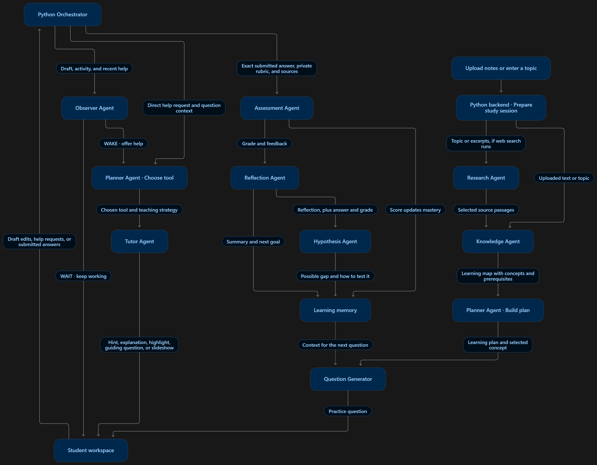
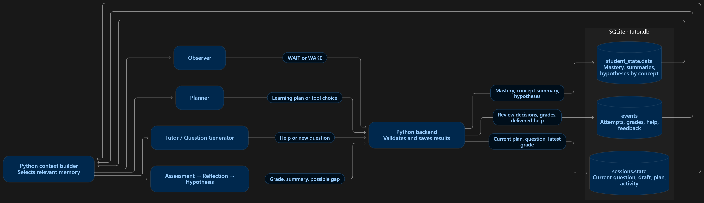

# Studyroom — Agentic AI Tutor

Describe what you want to learn or upload course notes. Studyroom builds a learning map and tutors you through text questions. It can research sources, offer proactive help, and generate interactive React Flow slideshows. The Memory tab shows what the tutor remembers across sessions.

The application uses FastAPI, React/TypeScript, SQLite, and the configured OpenAI or Gemini provider. Agents are cooperating Python modules; no external agent framework is required.

## Run

Use Python 3.11+ and Node.js 20.19+ or 22.12+.

```bash
python -m venv .venv
source .venv/bin/activate
python -m pip install -r requirements.txt
cp .env.example .env
npm ci
npm run build
python -m uvicorn backend.main:app --host 127.0.0.1 --port 8000
```

In PowerShell, activate the virtual environment with `.\.venv\Scripts\Activate.ps1`.

Configure one provider in `.env`:

```dotenv
LLM_PROVIDER=openai
OPENAI_API_KEY=your_key
OPENAI_MODEL=your_model
```

Or set `LLM_PROVIDER=gemini`, `GEMINI_API_KEY` and `GEMINI_MODEL`. Use a model your account can access. Keys stay on the backend. The configured provider handles extraction, planning, tutoring, grading and reflection; failures are reported rather than replaced with scripted teaching.

Open http://127.0.0.1:8000. For development, keep FastAPI running and use `npm run dev`, then open http://127.0.0.1:5173. Vite proxies `/api` and `/ws`.

Create an email/password account. Accounts own their materials, sessions, operations and learning memory. Passwords use scrypt; revocable login cookies are HttpOnly. Set `COOKIE_SECURE=true` for HTTPS and configure `CORS_ORIGINS` for additional development origins.

## Agent flow



The Python backend coordinates preparation. During study, the orchestrator routes help requests and submissions, then saves results that can inform the next question. See [the architecture notes](docs/ARCHITECTURE.md) for the detailed flow.

## Study and memory

- Enter a topic and learning goals, or upload up to ten text-based PDF, TXT or Markdown files. Each file is limited to 8 MiB and combined extracted text to 600,000 characters. Scanned PDFs require OCR.
- Preparation shows a short progress flow with the agent or component handling each step. If a topic is ambiguous, choose the intended meaning.
- The learning map shows concepts, prerequisites and any verified source quotes. Click an unlocked concept to focus on it.
- Practice questions and workspace answers are text-only.
- Request hints, explanations, text review, guiding questions, visualizations or web search. Automatic help can be disabled in the workspace.
- The Memory tab shows a read-only table of long-term memory by concept, including estimated mastery, summaries, possible gaps and next steps.
- Visualizations show a graph with highlighted nodes, step explanations, and playback controls.



## Observer

The Observer Agent decides WAIT or WAKE using recent activity, help, and assessment evidence. A pause after an edit or inactivity can trigger a routine review. An incorrect assessment gets priority. Reviews run for active, unanswered questions with proactive help enabled and wait for in-flight teaching and grading.

The Planner scores tools by successful deliveries on the current question. After a delivered hint, automatic tool choice switches to another tool. Students can still request a specific tool directly.

```dotenv
OBSERVER_LLM_ENABLED=true
OBSERVER_PAUSE_SECONDS=8
IDLE_SECONDS=60
OBSERVER_REVIEW_SECONDS=30
PROVIDER_CONCURRENCY=3
```

LLM grading is provisional. Assessment scores update mastery through Bayesian Knowledge Tracing. Reflection saves a learning summary and next goal, and Hypothesis analysis records possible gaps for future practice.

## Web research

```dotenv
WEB_SEARCH_PROVIDER=free
WEB_SEARCH_ON_UPLOAD=true
WEB_SEARCH_MAX_PAGES=4
WEB_SEARCH_TIMEOUT=15
```

`free` uses Wikipedia and DuckDuckGo. `gemini` fetches pages from Google grounding links and falls back to free search when needed. Set `WEB_SEARCH_ON_UPLOAD=false` to build upload maps from the files alone, or `WEB_SEARCH_PROVIDER=off` to disable web search across the app. Topic-only preparation needs usable web sources.

Accepted passages can be reused in study. Learning map quotes are optional and must match the supplied text to appear as evidence.

## Persistence and APIs

SQLite stores account/session state, append-only events, student memory, editable memory entries and preparation operations. Original material and retrieval chunks live under `data/materials`. Summaries retain the latest thirty entries. The app adds new tables on startup and preserves existing saved material and event history.

Important endpoints:

- `POST /api/material-jobs` — prepare uploaded files.
- `POST /api/material-jobs/topic` — prepare a topic description.
- `GET /api/operations/{id}` and `/events` — owned progress snapshots and resumable SSE.
- `POST /api/material-jobs/{id}/meaning` and `/retry` — clarify or retry a topic.
- `GET /api/sessions/{id}/memory` and `POST .../memory/corrections` — memory display and versioned corrections.
- `POST /api/sessions` with `preparation_id` — create or reopen the chat for a completed preparation.
- Existing session, material, student, study and `/ws/{id}` routes remain available. Schemas are at `/docs`.

Run one Uvicorn worker because task queues and locks live in that process. Reopen a saved chat from the sidebar to recover your work. If preparation is interrupted, choose the files again or retry the topic.

## Validation

```bash
python -m pytest -q
npm test
```

The ordinary suite mocks providers and search. Optional browser and paid model tests use the `RUN_BROWSER_TESTS` and `RUN_OPENAI_INTEGRATION` flags.

Model-facing instructions live in `backend/prompts.py` and the specialized research and Observer modules. Restart the backend after changing code or configuration. Logs are JSON lines under `tmp/logs`; do not publish them because model request logs contain student context.
