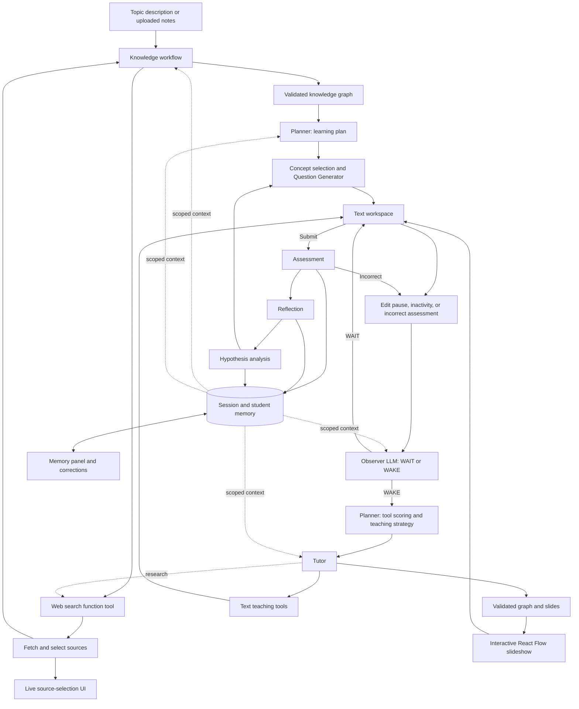

# Studyroom: agent flow and memory

## Full flow

1. **Describe a topic or upload notes.** A signed-in student supplies a topic, level and goals in a text box, or chooses PDF/TXT/MD material. The original request is retained.
2. **Create a preparation operation.** Its status and ordered progress events are stored in SQLite. The browser subscribes to its events and can restore progress after refreshing.
3. **Interpret the topic.** The Knowledge workflow uses student goals and learning memory to identify the intended subject. Ambiguous topic descriptions pause for a student-selected meaning.
4. **Research with native function calls.** The model calls `web_search` with a query, subject and purpose. Search retrieves real page text; the next model turn receives the tool result and its call ID. Gemini tool metadata is preserved across turns.
5. **Show source selection.** The UI shows candidates, readable-page checks, selection or rejection reasons, and supporting quotes. Quotes must match retrieved text. A bad quote rejects that page rather than discarding other sources. Selected sources survive a later research-provider failure.
6. **Build the Knowledge graph.** The model returns concepts, prerequisites and source-linked evidence. Quotes and references are checked, and unknown edges and cycles are removed. Uploads retain most of the extraction budget. Gemini uses a shallow JSON-string transport, followed by the same complete local graph validation.
7. **Create a learning plan.** The Planner receives the graph, request, relevant sources and memory. It creates objectives and steps. User-authored goals remain separate from the agent's suggested next goals.
8. **Choose a concept.** Python keeps the student's selected unlocked concept until mastered; otherwise it picks the weakest concept with satisfied prerequisites.
9. **Generate a question.** The Question Generator receives the plan, current concept, sources, hypotheses and recent questions. It can obtain extra research when evidence is missing. Questions and answers are text-only. The reference answer and rubric remain private.
10. **Save the student's work.** The browser debounces text edits for one second and sends visible-question idle signals every ten seconds. Text annotations never alter the response.
11. **Analyze the draft.** The Hypothesis agent reviews a stable draft after an eight-second pause, at most once every thirty seconds. Draft hypotheses are tentative session state, not long-term mastery updates.
12. **Decide whether to help.** The Observer LLM decides WAIT or WAKE after an edit pause, inactivity, or an incorrect assessment. Routine reviews are spaced thirty seconds apart by default. The UI shows the Observer's step and decision reason.
13. **Choose and deliver help.** After WAKE or a chat request, the Planner uses the current question's delivered-tool counts and the learning context to choose a tool. The Tutor produces a hint, explanation, text highlight, guiding question, or visualization brief. Students who name a tool get that tool.
14. **Show a visualization.** The Tutor generates graph nodes, edges, and slides. Python validates the references, and React Flow highlights the relevant nodes as the student advances through each slide.
15. **Assess and reflect.** The Assessment agent grades an immutable submitted text snapshot using the private rubric, reference and sources. Reflection saves a short learning summary and next goal. Hypothesis analysis combines the submission, assessment, reflection and prior evidence. Correct answers advance the study; incorrect answers retain the question.
16. **Inspect or correct memory, then continue or end.** The Memory tab displays session context, long-term mastery/goals/summaries and possible misconceptions. Corrections retain original evidence and history. End session stops pending reviews and preserves saved work.

## Shared context

`backend/context.py` assembles the current learning request, concept, text response, active plan, relevant history, retrieved passages, prerequisites, learning memory and hypotheses. Snapshots identify the question and response, plan and memory revisions. Context is bounded by dropping older history and lower-ranked passages; duplicated response text is removed from provider payloads.

- **Knowledge:** request, upload excerpts, goals and accepted research.
- **Planner:** graph, sources, eligible concepts, plan, goals, mastery and recent outcomes.
- **Question Generator:** concept, eligible prerequisites, plan, recent questions, sources and diagnostic hypotheses.
- **Observer LLM:** current work, activity, recent help, assessment evidence, and learning memory.
- **Tutor/Visualization:** selected pedagogical strategy, current work, relevant memory and evidence.
- **Assessment:** submitted snapshot plus private answer/rubric, learning context and sources.
- **Reflection/Hypothesis:** response, assessment, prior teaching, learning memory and evidence references.

## Memory and scores

See [the memory diagram and exact writer table](MEMORY.md) for which agent or Python component reads and updates each field.

See [the database schema reference](SCHEMA.md) for every SQL table and column, plus the JSON fields inside memory records.

Session memory lives in `sessions.state`. Long-term student memory lives in `student_state.data`. `memory_items` gives editable summaries, goals and misconceptions stable IDs, provenance and correction history. Events remain append-only. Preparation status and its associated chat live in `operations` and `operation_events`.

Students can correct summaries and goals and dispute misconceptions. Grades, mastery, and history are read-only. Corrections use a memory revision to reject stale saves. Student goals survive later agent-generated goal updates.

Assessment scores are provisional LLM judgments between zero and one. Mastery uses Bayesian Knowledge Tracing (`backend/student_model.py`): each concept stores P(known), updated by Bayes' rule on each attempt (score treated as soft evidence between the correct/wrong posteriors) followed by a learning transition. Defaults are P(L0)=0.3, P(T)=0.1, slip/guess 0.1/0.2 for verified checks and 0.15/0.25 for provisional LLM grading; they are hand-set, not fitted. Hypothesis confidence is assigned by the Hypothesis LLM, not computed from a Bayesian formula.

The Planner scores eligible tools as `1 / (1 + successful deliveries on the current question)`. A delivered hint removes hints from automatic selection until the next question. Explicit tool choices are honored.

The Observer waits for in-flight work and discards decisions when the reviewed state changes. If the model fails, the student continues working.

## Architecture

