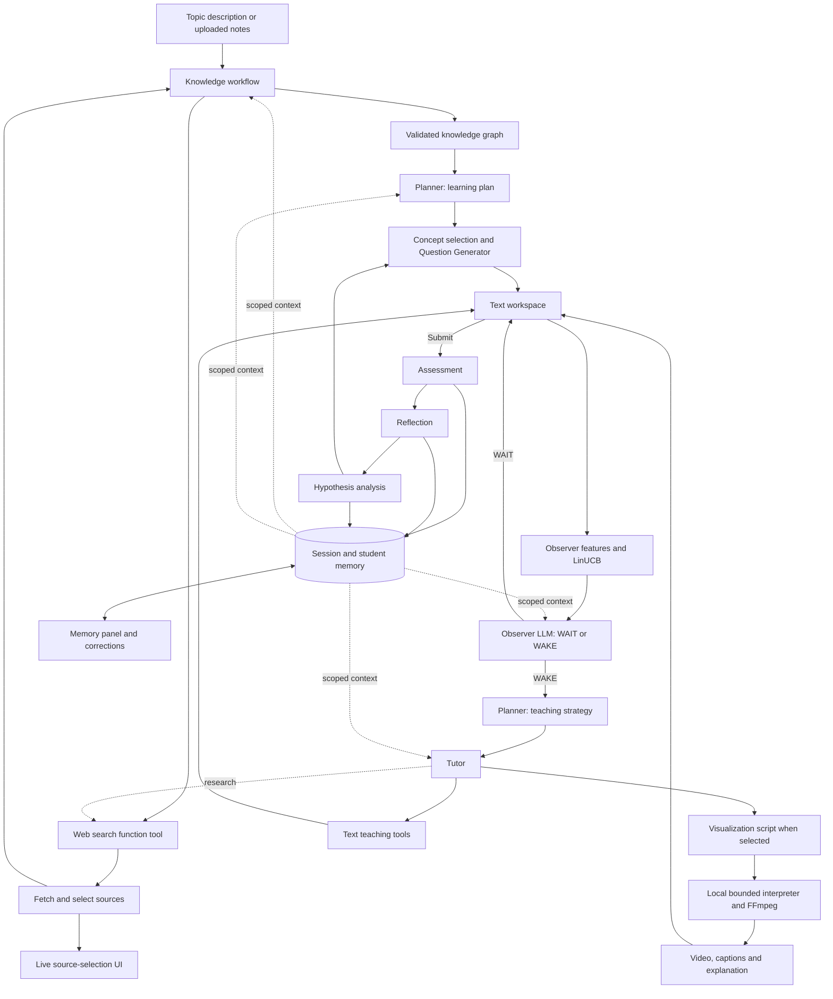

# Studyroom: agent flow and memory

## Full flow

1. **Describe a topic or upload notes.** A signed-in student supplies a topic, level and goals in a text box, or chooses PDF/TXT/MD material. The original request is retained.
2. **Create a preparation operation.** Its status and ordered progress events are stored in SQLite. The browser subscribes to its events and can restore progress after refreshing.
3. **Interpret the topic.** The Knowledge workflow uses student goals and learning memory to identify the intended subject. Ambiguous topic descriptions pause for a student-selected meaning.
4. **Research with native function calls.** The model calls `web_search` with a query, subject and purpose. Search retrieves real page text; the next model turn receives the tool result and its call ID. Gemini tool metadata is preserved across turns.
5. **Show source selection.** The UI shows candidates, readable-page checks, selection or rejection reasons, and supporting quotes. Quotes must match retrieved text. A bad quote rejects that page rather than discarding other sources. Selected sources survive a later research-provider failure.
6. **Build the Knowledge graph.** The model returns concepts, prerequisites and source-linked evidence. Quotes and references are checked, and unknown edges and cycles are removed. Uploads retain most of the extraction budget. Gemini uses a shallow JSON-string transport, followed by the same complete local graph validation.
7. **Create a learning plan.** The Planner receives the graph, request, relevant sources and memory. It creates objectives and steps. User-authored goals remain separate from the agent's suggested next goals.
8. **Choose a concept.** Python keeps the student's selected unlocked concept until mastered; otherwise it picks the weakest concept with satisfied prerequisites.
9. **Generate a question.** The Question Generator receives the plan, current concept, sources, hypotheses and recent questions. It can obtain extra research when evidence is missing. Questions and answers are text-only. The reference answer and rubric remain private.
10. **Save the student's work.** The browser debounces text edits for one second and sends visible-question idle signals every ten seconds. Text annotations never alter the response.
11. **Analyze the draft.** The Hypothesis agent reviews a stable draft after an eight-second pause, at most once every thirty seconds. Draft hypotheses are tentative session state, not long-term mastery updates.
12. **Decide whether to help.** The numerical Observer computes features and LinUCB recommendations. The Observer LLM can override WAIT or WAKE. Routine reviews wait for eight seconds of quiet and thirty seconds between calls. Assessment completion can trigger priority review. The UI displays the baseline, final decision and reason.
13. **Choose and deliver help.** After an approved WAKE, the Planner selects a teaching tool; it cannot veto help with `none`. The Tutor produces a hint, explanation, text highlight, guiding question, or a visualization brief. Explicit questions bypass automatic intervention eligibility. Manual Search web uses the same research tool and selection timeline.
14. **Render a visualization locally.** The visualization path generates a Python drawing script, chapters and a written explanation. A bounded interpreter evaluates the permitted Python drawing subset; generated code is never passed to `eval` or `exec`. A local worker renders Pillow frames and encodes H.264 MP4 through FFmpeg. No Docker is used. Rendering releases the teaching lock and publishes progress. Stale automatic results are discarded before delivery.
15. **Assess and reflect.** The Assessment agent grades an immutable submitted text snapshot using the private rubric, reference and sources. Reflection saves a short learning summary and next goal. Hypothesis analysis combines the submission, assessment, reflection and prior evidence. Correct answers advance the study; incorrect answers retain the question.
16. **Inspect or correct memory, then continue or end.** The Memory tab displays session context, long-term mastery/goals/summaries and possible misconceptions. Corrections retain original evidence and history. End session stops pending reviews and video delivery and preserves saved work.

## Shared context

`backend/context.py` assembles the current learning request, concept, text response, active plan, relevant history, retrieved passages, prerequisites, learning memory and hypotheses. Snapshots identify the question and response, plan and memory revisions. Context is bounded by dropping older history and lower-ranked passages; duplicated response text is removed from provider payloads.

- **Knowledge:** request, upload excerpts, goals and accepted research.
- **Planner:** graph, sources, eligible concepts, plan, goals, mastery and recent outcomes.
- **Question Generator:** concept, eligible prerequisites, plan, recent questions, sources and diagnostic hypotheses.
- **Observer LLM:** current work and memory plus activity features, numerical scores and recent interventions.
- **Tutor/Visualization:** selected pedagogical strategy or visual brief, current work, relevant memory and evidence.
- **Assessment:** submitted snapshot plus private answer/rubric, learning context and sources.
- **Reflection/Hypothesis:** response, assessment, prior teaching, learning memory and evidence references.
- **Renderer:** script and render settings only; no model credentials or student memory.

## Memory and scores

Session memory lives in `sessions.state`. Long-term student memory and policy parameters live in `student_state.data`. `memory_items` gives editable summaries, goals and misconceptions stable IDs, provenance and correction history. Events remain append-only. Preparation/video status lives in `operations` and `operation_events`.

Students can correct summaries/goals and dispute misconceptions. Grades, mastery, history and policy parameters are read-only. Corrections use a memory revision to reject stale saves. Student goals survive later agent-generated goal updates.

Assessment scores are provisional LLM judgments between zero and one. Mastery uses `new = 0.96 * old + 0.04 * score` for current LLM grading. Hypothesis confidence is assigned by the Hypothesis LLM, not computed from a Bayesian formula.

LinUCB evaluates WAIT and WAKE with nine scaled features plus an intercept:

`score = b.T @ solve(A, x) + 0.1 * sqrt(x.T @ solve(A, x))`.

Each action starts with `A = identity(10)` and `b = zeros(10)`. Usable feedback updates the executed action with `A += outer(x, x)` and `b += reward * x`. Its score is not a probability. LLM judgments do not reward themselves. Current grading is unverified; linked helpful/unhelpful feedback is the available live policy-training signal.

The Observer LLM respects disabled proactive help, inactive/solved questions, typing, assessment in progress and in-flight responses. Repeat automatic help cannot arrive within fifteen seconds; between fifteen and forty-five seconds it requires new meaningful response content or a new incorrect assessment. Model failure falls back to the numerical baseline and its normal cooldown.

## Local video contract

The model writes `def draw_frame(canvas, t):` using assignments, bounded loops, conditions, arithmetic, approved math calls and drawing helpers. Collections, numeric ranges and per-frame instructions are limited. Arbitrary imports, file/network access, classes, comprehensions and object introspection are unsupported.

Default output is 960×540 at 15 fps, around fifteen seconds and at most thirty seconds. The local worker has time, memory and file-size limits. An account-scoped content cache avoids rerendering identical scripts. Captions, seekable playback, chapters and a written explanation accompany the video. Linux/POSIX resource limits are used by the worker.

## Architecture

